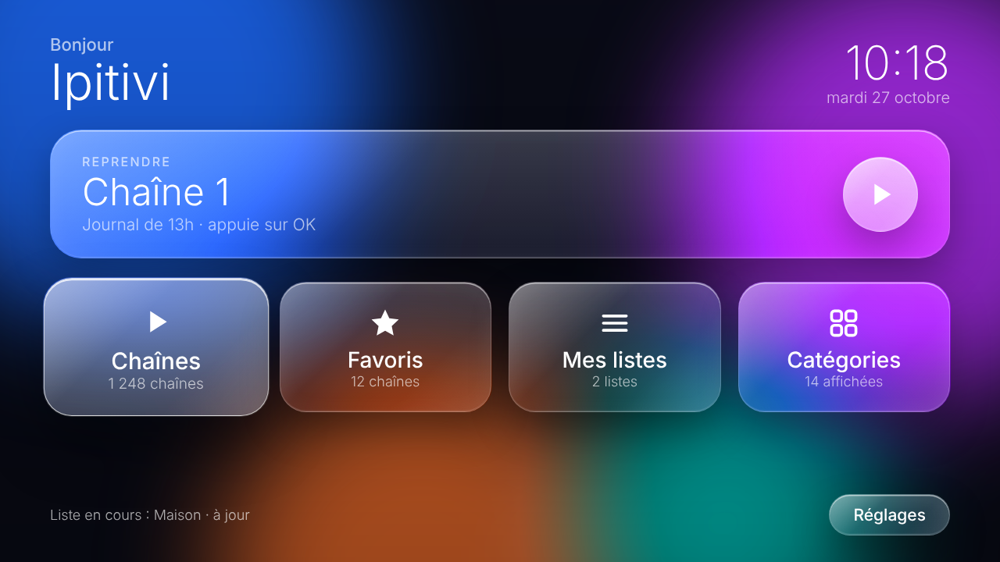
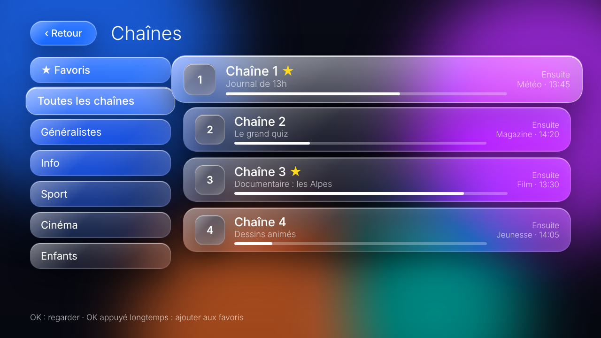
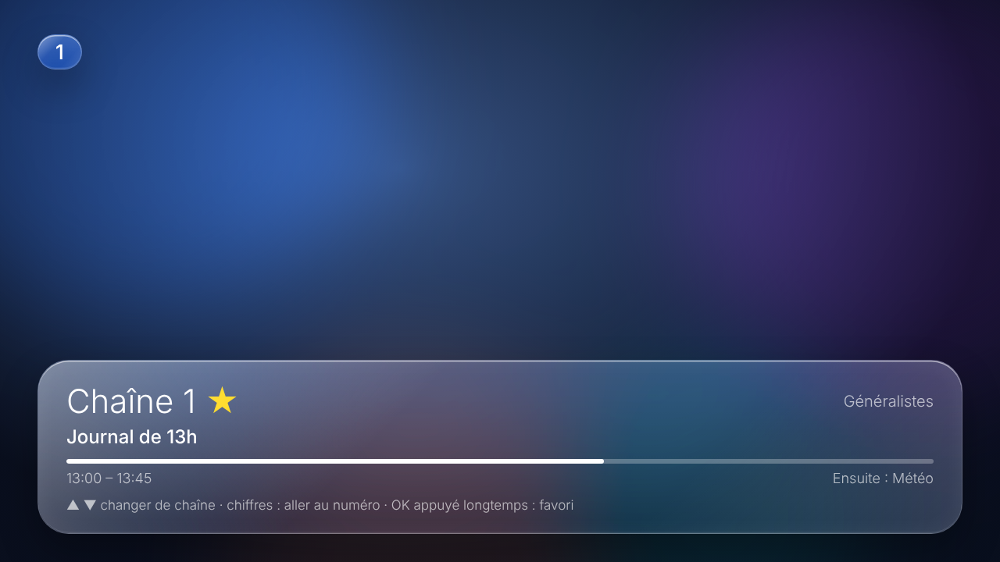
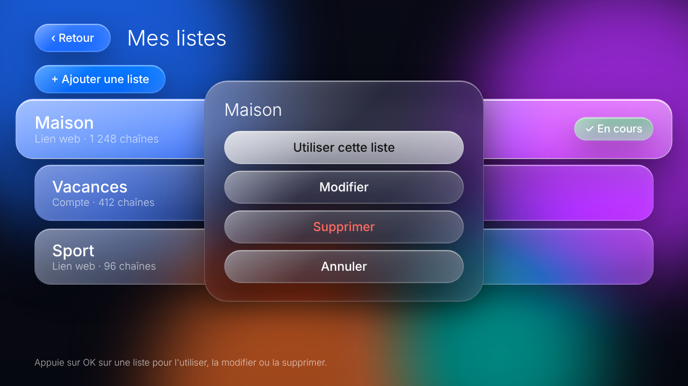
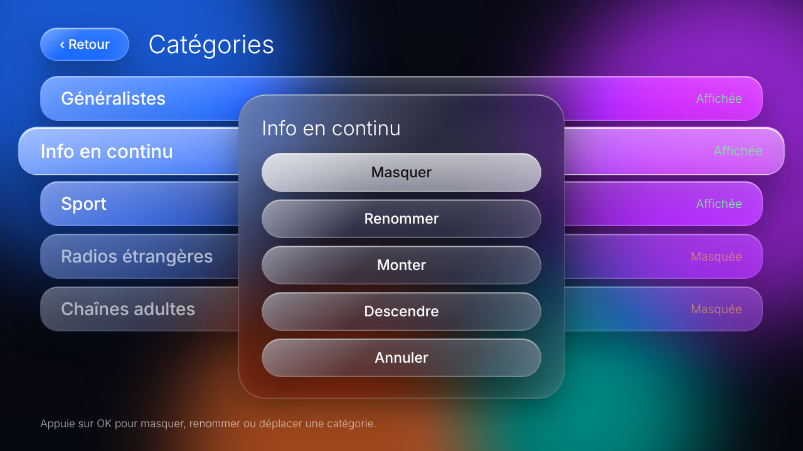

# Ipitivi

**A simple, beautiful IPTV player for Android TV, designed so that anyone, including older users, can use it.**
**Un lecteur IPTV simple et élégant pour Android TV, pensé pour que tout le monde, même les personnes âgées, sache s'en servir.**

<p align="center"></p>

> **Status / État :** early prototype, not yet released. / prototype en cours, pas encore publié.
> Ipitivi ships **no channels and no playlists**. You bring your own legally obtained source.
> Ipitivi ne fournit **aucune chaîne ni liste** : l'utilisateur apporte sa propre source, obtenue légalement.

---

## English

### Why Ipitivi?
Most Android TV IPTV players are made for power users: dense menus, many settings, hard to manage once you have several playlists and thousands of channels. Ipitivi is made for everyone else: a calm, Apple TV-style "liquid glass" interface, plain wording, big buttons and adjustable text size.

### Features
- **Home screen with one big "Resume" button** and four large cards: Channels, Favourites, My lists, Categories.
- **Easy playlist management**: keep several lists (M3U link or Xtream account); add, edit, delete, or choose the active one.
- **Easy category management**: hide, rename and reorder categories, per playlist.
- **Programme guide (EPG)** from XMLTV, with "now / next" and a progress bar.
- **Favourites** (long-press OK) and **up/down channel zapping**, number keys to jump to a channel.
- **Automatic reconnection** when a stream drops.
- **Text size** setting: normal / large / very large.
- No tracking, no ads, no analytics.

### Screenshots
| Channels | Player |
|---|---|
|  |  |
| **My lists** | **Categories** |
|  |  |

*The screenshots are design mockups of the interface; replace them with real captures from a TV when available.*

### Build and install
Requirements: JDK 17, Android SDK 34, an Android TV with network (ADB) debugging enabled.

```
chmod +x gradlew build-and-install.sh
TV_HOST=<tv-ip> ./build-and-install.sh
```
The script runs the unit tests, builds the debug APK and installs it on the TV. To build only: `./gradlew testDebugUnitTest assembleDebug`.

### Tech
Plain Java, AndroidX RecyclerView, Media3 ExoPlayer. The UI is built in code (no XML layouts). Parsing and storage logic (M3U, XMLTV, Xtream, playlists, categories) is pure Java with unit tests (`./gradlew testDebugUnitTest`).

### Roadmap
- Movies and series (Xtream VOD: seasons, episodes, resume playback)
- "Continue watching" row
- More accessibility options for older users
- Play Store release

### Legal
Ipitivi is a media player. It provides no content and does not link to any provider. You are responsible for using it only with sources you are legally entitled to access.

### Contributing
Issues and pull requests are welcome, especially feedback from older or non-technical users. See [CONTRIBUTING.md](CONTRIBUTING.md).

---

## Français

### Pourquoi Ipitivi ?
La plupart des lecteurs IPTV pour Android TV sont conçus pour des utilisateurs avancés : menus denses, nombreux réglages, difficiles à gérer avec plusieurs listes et des milliers de chaînes. Ipitivi s'adresse aux autres : une interface calme de style Apple TV « liquid glass », des mots simples, de gros boutons et une taille de texte réglable.

### Fonctions
- **Accueil** avec un grand bouton « Reprendre » et quatre cartes : Chaînes, Favoris, Mes listes, Catégories.
- **Gestion simple des listes** : plusieurs listes (lien M3U ou compte Xtream), ajout, modification, suppression, choix de la liste en cours.
- **Gestion simple des catégories** : masquer, renommer, réordonner, pour chaque liste.
- **Guide des programmes (EPG)** XMLTV, avec « en cours / ensuite » et barre de progression.
- **Favoris** (OK appuyé longtemps), **zapping ▲ ▼**, touches numériques.
- **Reconnexion automatique** si le flux coupe.
- **Taille du texte** : normale / grande / très grande.
- Aucun pistage, aucune publicité.

### Installer
Prérequis : JDK 17, SDK Android 34, une Android TV avec le débogage réseau (ADB) activé.

```
chmod +x gradlew build-and-install.sh
TV_HOST=<ip-de-la-tv> ./build-and-install.sh
```
Désinstaller : `adb shell pm uninstall com.robin.ipitivi`

### Mentions légales
Ipitivi est un lecteur multimédia. Elle ne fournit aucun contenu et ne renvoie vers aucun fournisseur. L'utilisateur est responsable de n'utiliser que des sources auxquelles il a légalement accès.

## License
MIT, see [LICENSE](LICENSE).
